# Drive Roadster — VRChat world

オリジナルの電動スポーツカー **DR Asterion** で空港コースを走る PC / PCVR 向けワールドです。スポーン横に **32台（各1席）** を配置し、フリー走行と個人タイムアタックを実装しています。

## 2026-10-18 空港コース更新

保存シーンは `Assets/DriveRoadster/Scenes/DriveRoadster.unity`。更新前の編集中シーンを `BeforeAirport_20261018.unity` に保全しています。

- 敷地1,800×1,600m、メインコース約3,293m、順序付き14ゲート。滑走路・S字・バンク・ヘアピン・飛行区間と、別の天井走行／垂直カール練習区画があります。
- Meshyの管制塔・格納庫・ターミナル3種類を12棟として配置。meshy-t2.5、2K PBR、FBX。実測6,146～7,677三角形／種類、承認済み45クレジットを使用しました。生成IDは `Art/Airport/Meshy/generation.json`。
- 共通 `Prefabs/Asterion_Shared.prefab` を32台で使用し、共通車体・LOD・内装・音源を参照。番号付きアクセントのテクスチャ／マテリアルのみ各車で変更。旧コース上の車はアクティブシーンから撤去しました。
- [指定されたTesla動画](https://www.youtube.com/watch?v=r5vsHHPVhJg)を参考に、オリジナル合成のEV音・走行風・ガス噴射・着地音を搭載。動画の音声ファイルは配布アセットに含めていません。スモークを増量し、各車最大2,560粒子、160m以遠では新規放出を抑制します。
- 乗車時に一度だけ実際の頭の高さから補正し、設計視点1.08mへ合わせます（初回空港版の0.98mから10cm上昇）。車内ボタンから上下調整でき、その後のHMDの動きには追従補正しません。ルーフ内張りと両面ガラス、2cm近クリップの参照カメラを設定しました。
- START/FINISH等の文字を正向き・両面のUnity文字へ置換。文字用シェーダーで背面文字の透け重なりを修正しました。入口に日本語操作ガイド・コース図を配置しています。
- オリジナルのエレクトロBGM3曲と、入口のローカルON/OFF・曲送り・音量操作盤を実装。音楽は各プレイヤー個別で、他人の設定を変更しません。

TAは駐車場では始まりません。START手前の `STOP + T` 枠で停止しTを押して、スタートを横切ると時計が始まります。Backspace／RESETは各車固有の駐車枠へ、EXITは入口へ戻ります。

### バンク・ニュートラル・平地ジャンプの修正

バンクは右カーブの外側（左端）を高くし、内側へ傾く向きに修正。低い側の路面も地面より上に保ち、路面・縁石・誘導線・コライダーを揃えました。キーボードを離すとスロットルは次の物理更新で即座に0になり、車体は惰性で進みます。Station内でSDK入力が残った場合も、実キーの解放で解除します。

平地では **Spaceを1回押すとジャンプ**（Auto / Manual共通）。四隅の下向きノズルが一斉噴射します。空中姿勢を操作する場合は、地上で **F → Manual → キーを離す → Spaceでジャンプ → 離陸後も約0.15秒キーを離す** と操作可能になります。

| Manual空中操作 | 車体の動きと強く噴くノズル |
|---|---|
| W / S | 機首下げ / 上げ。後方2基 / 前方2基 |
| Q / E | 左 / 右ロール。右側2基 / 左側2基 |
| A / D | 左 / 右ヨー。対応する横向きノズル |
| Space / Shift | 後方排気による前進推力 / 制動 |
| F / L | Auto水平復帰へ切替 / 着陸補助ON・OFF |

Manualは無入力で回転を減衰しますが、姿勢を自動で水平に戻しません。着地前に車体を起こしてください。Spaceの押しっぱなしでは着地時に再ジャンプしません。VRは右グリップでヨークを持ってJump、Manual空中は右手首でピッチ・ロールを操作します。入口の専用看板と車内Hヘルプにも掲載しています。

この修正のClientSim検証は22/22項目成功。バンク69断面の傾きと102地点の路面コライダー、入力解放、Auto/Manualの平地ジャンプ、ピッチ／ロール4方向とノズルの対応を検査しました。[検証結果](docs/validation/airport-controls.json)。キー押下とQ/Eは検証用入力を使用し、未押下状態での実キー解放判定も確認。実HMD・複数クライアントは未検証です。

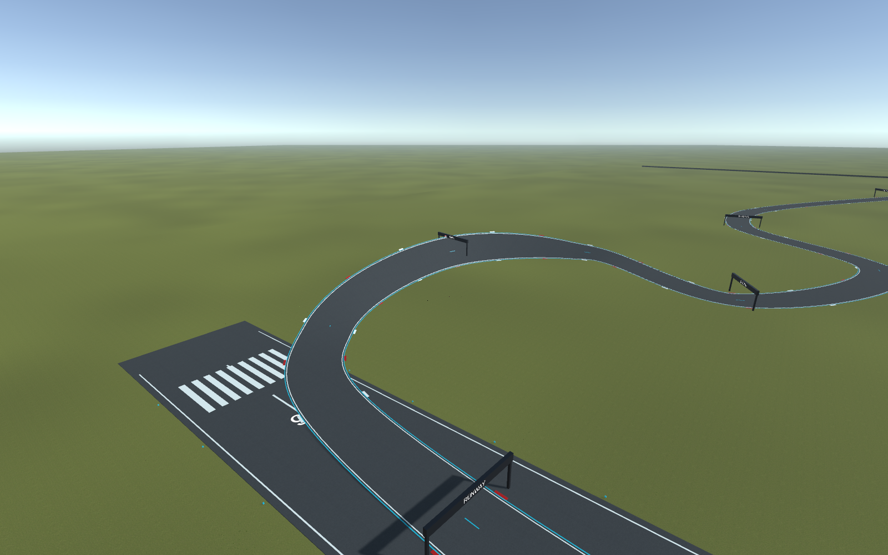

### 視点調整と斜面吸着ファン

車内操作盤の **VIEW −／DEFAULT／VIEW ＋**、または **PageDown／Home／PageUp** で目線を変更します。1回2cm、車体ローカルY=0.96〜1.12m、標準1.08m。アバターごとの乗車補正と手動調整を分け、屋根を抜けない範囲に制限しています。操作盤はVRのInteractにも対応。走行中も調整できます。

斜面では自動ファンが路面へ向けて最大 **2G（19.62m/s²）** を加え、実際の重力と別に計算します。8〜15度で立ち上がり、それ以上では最大出力。押し付け荷重に応じたタイヤの横グリップと姿勢追従で、垂直壁や逆さの路面でも接触を維持します。接地中だけ最大22cmのサスペンション隙間を補い、離陸要求時は解除、空中では吸着しません。車内にFANのG表示、共通のオリジナルファン音を追加。音は無人時・空中・遠距離では停止します。これはゲーム内の要求仕様としての2Gで、実車の内部機構を再現したものではありません。

更新の再適用は `Drive Roadster → Update cockpit height and surface fans`、検証入口は `RoadsterSeatFanValidation.Begin()`。原音の生成は `SourceAssets/build_surface_fan_audio.py`。ClientSim **30/30項目成功**：[検証結果](docs/validation/airport-seat-fan.json)。車内ボタン、実際の着座頭部位置、58度バンク・90度壁・180度天井の一時検証路面、実コースの変化する傾斜、離陸・空中解除を確認しました。既存の操縦回帰試験22/22、Python静的・数理検査33/33も成功。実HMDと複数クライアントは未検証です。

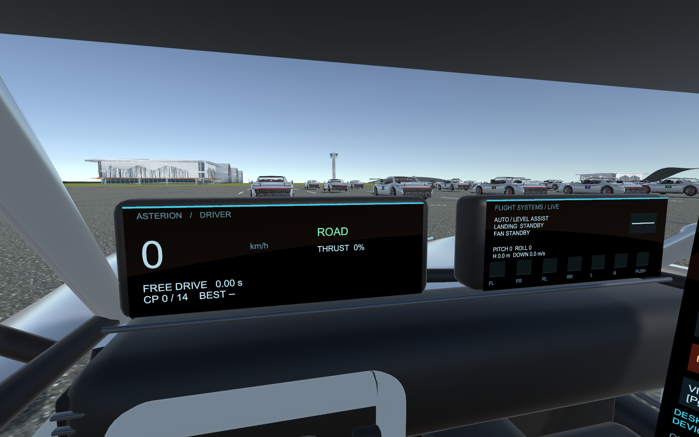

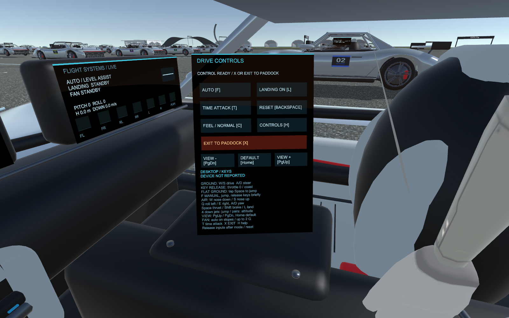

### 地面テクスチャと軽量な草

草地とアスファルトのタイルテクスチャをimage_genで生成し、`Assets/DriveRoadster/Art/Airport/Surfaces/` に保存。Unityでは最大1024px、圧縮・ミップマップ・異方性4を使用し、ワールド座標で貼り付けます。ミラー反復と回転した副サンプルで境界と反復を目立ちにくくしています。[生成プロンプトと設定](SourceAssets/airport-surface-generation.json)。

草は335区画で近距離1,200三角形／遠距離240三角形の2つの共通メッシュと1つのGPUインスタンシング対応材質を再利用。LODと90〜150mの縮小で遠景の描画を抑え、影・Collider・草用Updateスクリプトは使用しません。路面・駐車場・建物・練習区画を避けて配置。実HMDのフレーム時間は未測定です。再適用は `Drive Roadster → Apply textured ground and light grass`。[構成記録](docs/validation/airport-ground.json)。

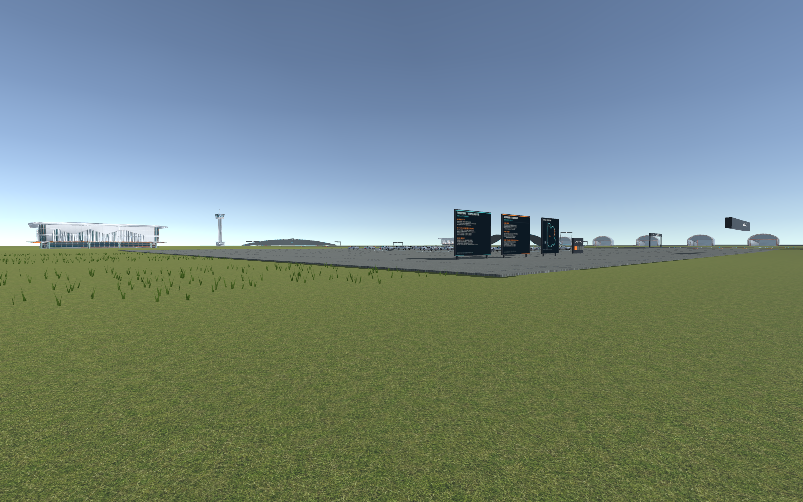

**初回空港版の検証:** C#・UdonSharpコンパイル成功。ClientSimによる新機能27/27項目成功、メイン路面242地点のコライダー検査成功。当時のClientSim着座視点は車体基準Y=0.98m（現在は上記の1.08m）。結果は `docs/validation/airport-clientsim.json` と `airport-road-colliders.json`。実HMD、32人同時のネットワーク、連続した全周走行、VRChat Build & Test／アップロードは未実施です。

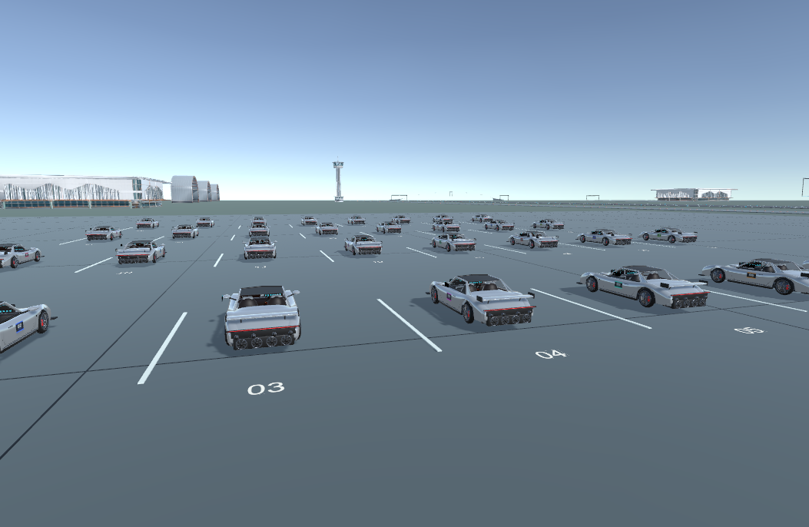

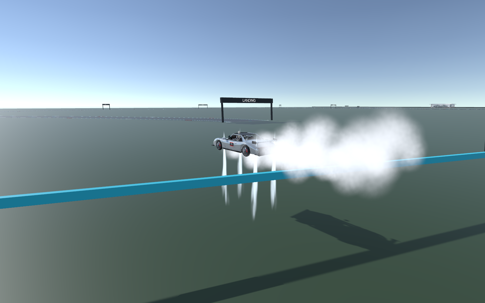

再生成は `Drive Roadster → Upgrade to 32 car airport`。これは現在のDriveRoadsterWorld配下のコースを置き換えます。旧試作向けの `Build vertical slice scene` は下記の旧コースを生成する別機能です。原音・番号テクスチャ・入口看板は `SourceAssets/build_airport_assets.py`、空港形状と配置は `RoadsterAirportUpgrade.cs`、新機能検証は `RoadsterAirportValidation.Begin()` で再現できます。

## 2026-10-17 旧コースの検証履歴

以下は以前の1台・海上コースの記録です。車両物理と入力の説明は引き継いでいますが、配置・コース・音・視点・同期の無人時更新間隔は上記の更新が優先します。

2026-10-17、Windows 上の **Unity 2022.3.22f1 / VRChat SDK 3.10.5** で C#・UdonSharp コンパイルとシーン構築を実施しました。**ClientSim の区間スモーク試験 105/105 項目成功**。乗降、直線加速、タイムアタックの START 通過、リセット、バンク接地、LAUNCH 通過からのアシスト飛行、不連続移動による失格、姿勢補助・3層白煙・着陸補助を確認しています。車内計器、Auto/Manual、独立3軸、左右トリガーのブレーキ優先、仮想ヨーク、入力解除、独立着陸補助、EXITも検証しました。デスクトップのQ/E・Shiftはキー状態の注入、VRは合成したSDK識別・右手追跡データを含む試験です。

Python 静的・数理検査 33 件と C# 構文解析も成功。実行条件と生の検査値は [Unity 検証記録](docs/validation/UNITY_VALIDATION.ja.md) / [JSON](docs/validation/clientsim-smoke.json) を参照してください。

**VRChat ワールドへのアップロード、VRChat Build & Test、HMD、複数クライアント、完全な 1 周の受入試験は未検証です。** ClientSim は Unity Editor 内のシミュレーターです。ネットワーク同期、VR の視認性・酔い・操作性、公開ワールドの性能を保証する結果ではありません。

## Unity Play Mode の画像

以下は **Unity Editor Play Mode / ClientSim、ローカル simulated player 1 人** で撮影した Game View です。自動入力と検証用追従カメラを使用しています。左上は検証用 HUD。VRChat 実クライアントの画像ではありません。

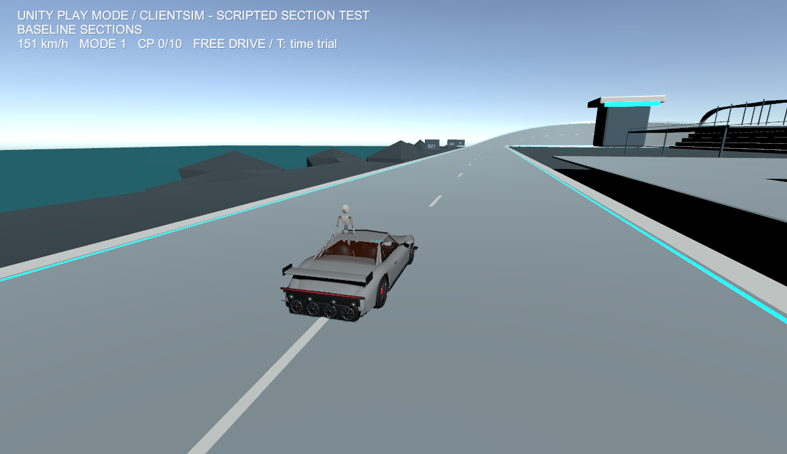

直線で静止から加速したフリー走行。mode 1。カメラと HUD は検証時だけ追加しています。

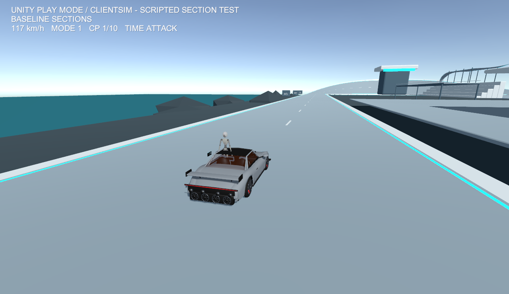

タイムアタックを開始して START を通過した状態（CP 1/10）。一周完走は未検証です。

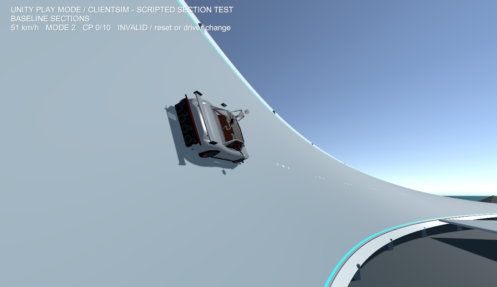

72 度バンクの途中へ位置・姿勢・初速を設定した区間試験。mode 2 の接地を確認しました。直線からの連続進入試験ではありません。

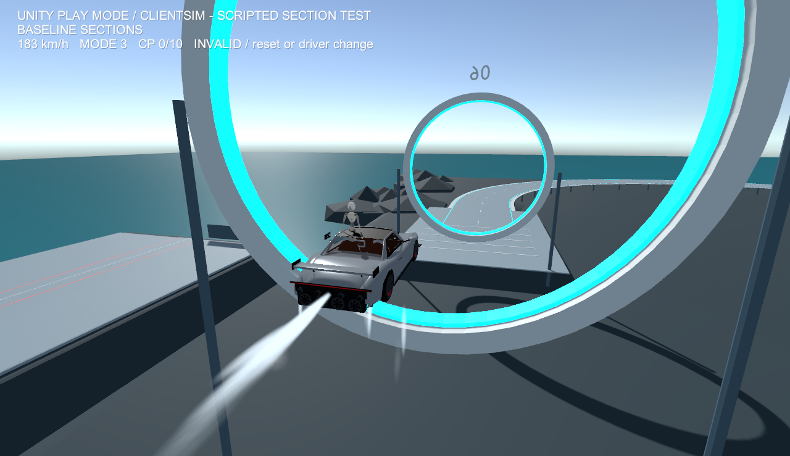

LAUNCH 手前へ配置してからゲート面を横切り、mode 3 に移行した飛行区間。着地・完走は未検証です。バンクと飛行の INVALID 表示は、先行する計測をリセットして自由走行の試験へ移った結果です。

## スラスター姿勢制御・白煙・着地

公式 [Kickflip](https://x.com/Tesla/status/2110926164306931860) / [Ramp](https://x.com/Tesla/status/2110913438293647789) の回転中の噴流、接地前から広がる雲、停止後の残留霧を再観察して追加しました。映像の見える振る舞いを参考にしたゲーム補助であり、実車の内部機構や性能を断定する実装ではありません。時刻付き観察、式、全パラメーター、ノズル対応は [詳細技術資料](docs/THRUSTERS.ja.md) を参照してください。

- **姿勢**: Autoは空中のQuaternion姿勢誤差と実角速度からPDトルクを算出。Manualは3軸の角速度要求と実角速度の差を使用し、水平復帰しません。四隅の下向きノズルと左右ノズルの強弱を、その補正の方向に対応させます。ジェット方向は車体の回転に追従します。
- **着陸**: 路面までの高さと接近速度から接地前の制動量を計算。最大42 m/s²の車体上向き補助で降下を緩和し、接地後0.35秒の過大反発を抑えます。地上では着陸噴射を止めます。低高度で降下中は既存の滑空揚力を解除し、着陸制動との重複を防ぎます。
- **白煙**: 細い Local ジェット、World の残留煙、排気方向の Raycast が路面へ当たった地点の拡散霧の3層。接地前から霧を生成し、噴射停止後も寿命まで残ります。
- **負荷と同期**: 18個の ParticleSystem を再利用、最大1,280粒子。7噴射強度を2個の同期 int へ量子化し、既存スナップショットで送ります。物理は owner のみ。実ネットワークと GPU 負荷は未測定です。


Unity Editor Play Mode / ClientSim。傾けて配置した車体の姿勢復元中。スクリプトによる区間検証で、公式映像ではありません。


同環境。高さ7 m・初期降下速度11 m/sの自動垂直降下で、接地前に制動と白煙が発生。


同環境。接地付近の路面上の霧。[噴射停止後の残留画像](docs/images/clientsim-thruster-residual.png)も掲載しています。

補助オン／オフ比較は別の共通条件（高さ7 m、降下11 m/s、前進12 m/s）で行いました。実測値は [検証報告](docs/validation/UNITY_VALIDATION.ja.md) と [JSON](docs/validation/clientsim-smoke.json) に記載しています。地上での静止、横速度の維持、煙の寿命も確認しました。連続した全周走行・斜面を含む全着地条件・HMD・複数クライアントは未検証です。

## 車内と操作系統

灰白色シート、黒いダッシュボード、角丸長方形ヨーク、独立したアクセル／ブレーキペダル、計器の筐体とセンターコンソールを更新しました。銅色の閉じたキャノピーなど既存の外観を引き継ぎ、詳細な内装・計器配置はゲーム独自の設計です。編集可能な `.blend` と全3段階の FBX / GLB を同梱しています。

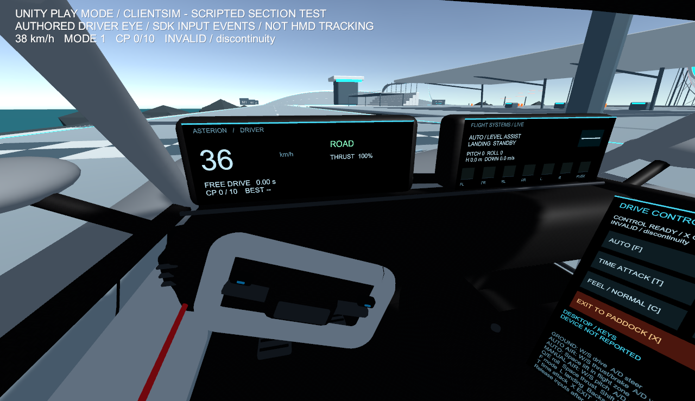

Unity Editor Play Mode / ClientSim。設計上の `CockpitEye_AuthoredReference` から撮影。実速度、ROAD モード、操作入力、CP／ラップ表示を描画しています。撮影用カメラでは ClientSim の仮アバターを非表示にしています。実アバターの着座視点や HMD トラッキングの検証画像ではありません。

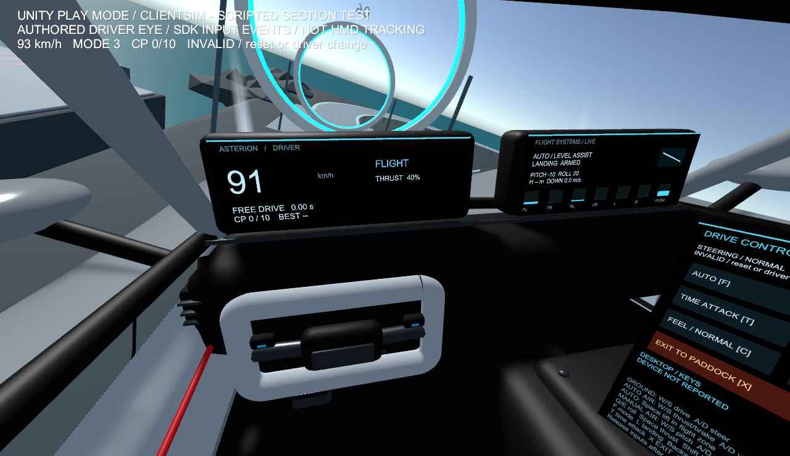

同じ設計視点。空中に姿勢・初速を設定して飛行補助を有効にした区間試験。ピッチ／ロール、路面までの距離、接近速度、7系統の噴射要求を実状態から表示します。`INVALID` は直前の計測解除によるもので、完走画像ではありません。

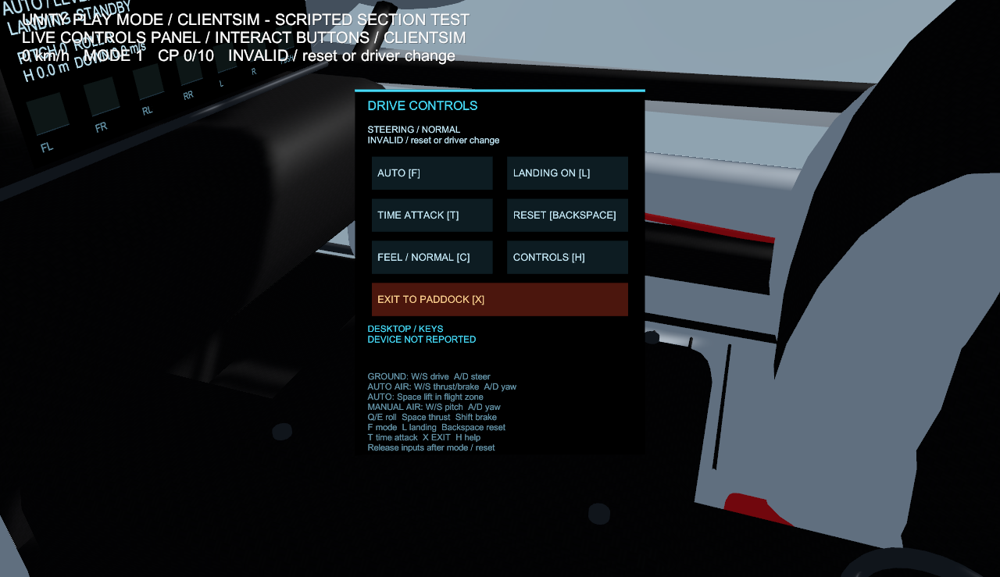

同環境のパネル確認用カメラ。7個のInteractボタンでAuto/Manual、着陸補助、TA開始、リセット、感度、ヘルプ、退出を操作します。映像用の飾りスイッチと動作するボタンは [車内技術資料](docs/COCKPIT.ja.md) で区別しています。

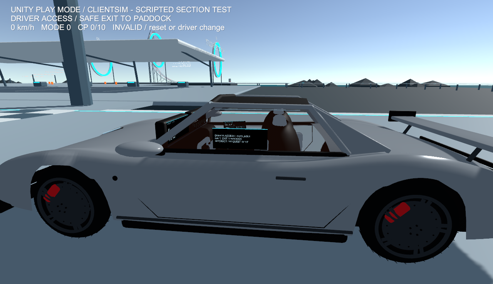

同環境。降車後の AVAILABLE 表示。ドア側の乗車操作から所有権要求・Station 着座へ進みます。

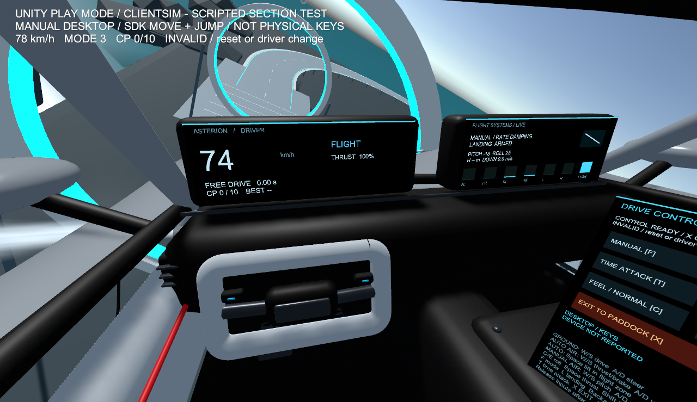

Unity Editor Play Mode / ClientSim。SDK入力イベントによるManualの区間試験。物理キーボード操作ではありません。

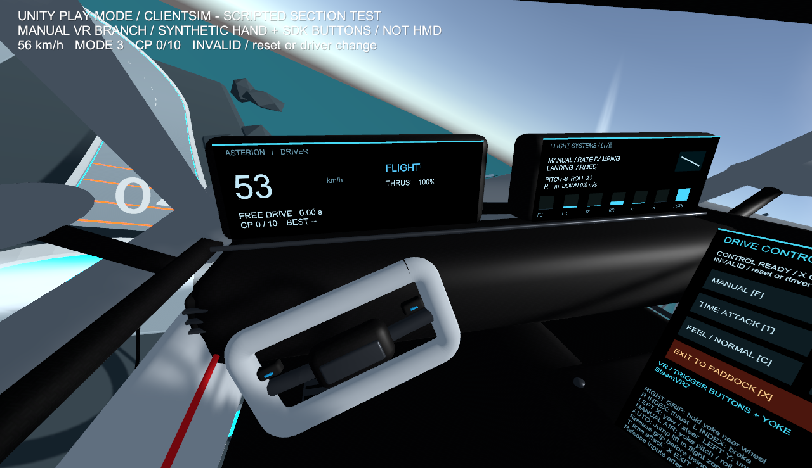

同じGame View。VR識別と右手姿勢をEditor限定フィクスチャで供給し、左右ボタンと移動イベントを送信しています。**実HMD・実コントローラーの画像ではありません。**

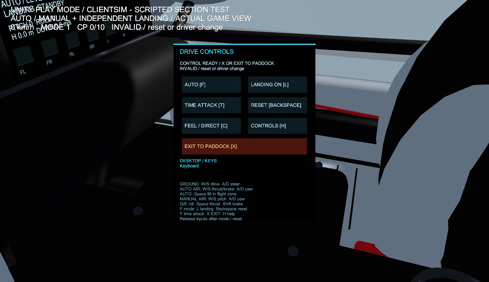

同環境のパネル確認用カメラ。Auto/Manualと着陸補助を別々に表示・操作します。

## 操作

乗車時は **Auto・着陸補助ON**。Manualは空中の操縦方式を切り替え、地上は通常運転です。左右人差し指トリガーは `InputUse(bool, handType)` の押下で読み、立上り／解除を平滑化します。握り量の連続アナログ取得には依存しません。

| 操作 | Desktop | VR |
|---|---|---|
| 乗車 | DRIVER ACCESS / 車体をInteract | 同じ場所をInteract |
| 地上加速 | W | 右人差し指トリガー。右グリップでヨークを保持中のみ |
| 地上制動 | S（停止後は後退） | 左人差し指トリガー。停止後に後退しない |
| 地上操舵／空中yaw | A / D | 左スティック左右。右ヨーク保持中 |
| Auto空中推力／制動 | W / S | 右／左人差し指トリガー |
| 平地ジャンプ（両モード） | Spaceを1回押す | 右ヨーク保持中にJumpを1回押す |
| Auto飛行区間での上昇 | Jump（標準Space）を保持 | Jumpを保持。右ヨーク保持中 |
| Manual空中pitch | W＝機首下げ、S＝機首上げ | 握った右手ヨークの前後傾き |
| Manual空中roll | Q＝左、E＝右 | 握った右手ヨークの左右傾き |
| Manual空中推力／制動 | Space / Shift | 右／左人差し指トリガー |
| ヨーク取得／解放 | 不要 | ヨークの近くで右グリップ。解放または手を離すと解除 |
| Auto / Manual | F / モードボタン | モードボタンをInteract |
| 着陸補助ON / OFF | L / LANDINGボタン | LANDINGボタンをInteract |
| スタートへ復帰 | Backspace / RESET | RESETをInteract |
| TA / 感度 / ヘルプ | T / C / H、または車内ボタン | 車内ボタンをInteract |
| 降車 | X / EXIT | 車内EXIT（キーボードXも可） |

**VR左スティック前後は未使用**。右スティック／Lookイベントも操縦には使いません。ManualのVR Jumpには推力を重複割当しません。視点は通常のマウス／HMDに任せます。RはVRChat標準Action Menu用に空けました。

平地ジャンプは飛行ゲートを通らず使えます。ジャンプ中は空中姿勢・前進推力・制動が使え、着地でジャンプ状態を終了します。Autoの継続上昇・滑空補助は **LAUNCH通過後の許可区間内のみ**。Jumpは降車に使いません。Manualでは無入力時の角速度を減衰しますが、水平へは戻しません。着陸補助はモードと独立し、Manualの姿勢を勝手に起こしません。強く傾いて補助できないときは `LANDING CHECK ATTITUDE` を表示します。

右グリップのヨーク取得には両トリガーの解放が必要です。両トリガー同時はブレーキ優先で、正の推力を即座に解除します。右ヨーク解放・距離超過・車内パネル操作ではアクセルを切ります。再取得だけで押しっぱなしのアクセルが復活することはありません。

乗車、リセット、Auto/Manual切替、着陸補助切替、パネル操作、Manualの地上／空中切替、所有権通知、入力方式の系統変更、SDK休止／長い処理中断では入力をクリアします。入力を中立に戻して0.15秒待ってから再開します。Keyboard↔Mouseの通常の切替だけでは操縦を解除しません。移動やJumpによるStation自動退出は無効で、EXITはパドックへ戻ります。速度2 m/s超のリセットは2秒以内の二度押しです。

SDK 3.10.5は `Application.isFocused` をUdonへ公開していません。SDKの入力解除と休止・処理中断は処理しますが、実Alt-Tab、SteamVRダッシュボード、トラッキング喪失時の通知は未検証です。実HMDのリマップ、手の到達性、VR快適性も未検証。VRコントローラーの押下と手姿勢はClientSimの合成入力で検証しています。

タイムアタックはスタートから8 m以内・速度1 m/s以下で開始し、START → ACCEL → WALL_APEX → LAUNCH → AIR_01 → AIR_02 → AIR_03 → LANDING → RETURN → FINISHの順に通過します。リセット・運転者変更・不連続移動・不正なゲート通過は失格です。

Meta Touchの物理入力、OpenXRプロファイル、Udon公開イベントの対応と追加試験は[Meta入力バインド資料](docs/INPUT_BINDINGS_META.ja.md)に掲載しています。

## 導入と再現

検証に使用した Unity は **2022.3.22f1 (887be4894c44)**、VRChat Base / Worlds SDK は **3.10.5** です。[VRChat が指定する Unity](https://creators.vrchat.com/sdk/upgrade/current-unity-version/)を導入時にも確認してください。

1. このリポジトリを clone します。`Assets`、`Packages`、`ProjectSettings` を含む Unity プロジェクトです。
2. [VRChat Creator Companion](https://vcc.docs.vrchat.com/) に既存プロジェクトとして追加し、`Packages/vpm-manifest.json` の Base / Worlds / VPM Resolver を復元します。SDK のソースとバイナリはリポジトリへ再配布していません。新規 Worlds プロジェクトへ `Assets/DriveRoadster` をコピーする方法も利用できます。
3. Unity 2022.3.22f1 で開き、Package Manager の復元とスクリプトコンパイル完了を待ちます。
4. 保存済みの `Assets/DriveRoadster/Scenes/DriveRoadster.unity` を開きます。再生成する場合は **Drive Roadster → Build vertical slice scene** を実行します。ビルダーは既存シーンの保存を確認し、生成先を連番化します。
5. UdonSharp をコンパイルします。Play Mode で ClientSim を有効にして乗降・走行を試します。
6. 自動スモーク試験は **Drive Roadster → Run ClientSim smoke validation**。結果を `docs/validation/clientsim-smoke.json`、画像を `docs/images/` へ保存します。同名の検証成果物は更新されます。実行中のプロジェクトを保存してから利用してください。
7. 公開前に SDK Validation と VRChat Build & Test、および [実機受入試験](docs/ACCEPTANCE_TESTS.ja.md) を実施してください。今回の作業ではワールドをアップロードしていません。

`RoadsterValidation.BuildScene`は再生成した結果を保存済みの`DriveRoadster.unity`へ置き換える検証用入口です。手編集シーンを保存・保全してから実行してください。バッチでのシーン再生成はUnityの `-batchmode -projectPath <project> -executeMethod RoadsterValidation.BuildScene -quit -logFile <log>` で実行できます。画像を伴う検証は描画可能な Editor から `-executeMethod RoadsterValidation.Run -roadsterExit` を指定します。`-quit` を併用しないでください。

## ファイル構成

| 場所 | 用途 |
|---|---|
| `Assets/DriveRoadster/Scripts/RoadsterVehicle.cs` | 乗降、所有権、車両物理、入力、スナップショット同期 |
| `Assets/DriveRoadster/Scripts/RoadsterRun.cs` | ゲート判定、タイマー、失格、参考記録、HUD |
| `Assets/DriveRoadster/Scripts/RoadsterAction.cs` | 乗車と10種の車内 Interact、押下演出 |
| `Assets/DriveRoadster/Editor/BuildRoadsterWorld.cs` | FBX と manifest からシーン・座席・HUD・LOD を生成 |
| `Assets/DriveRoadster/Editor/RoadsterCockpitSetup.cs` | 生計器、ボタン、乗車表示、可動部ピボットを生成 |
| `Assets/DriveRoadster/Editor/RoadsterThrusterSetup.cs` | ノズル参照と3層のParticleSystem・白煙材質を生成 |
| `Assets/DriveRoadster/Editor/RoadsterValidation.cs` | Editor 限定 ClientSim 検証。ワールド実行コードには含まれない |
| `Assets/DriveRoadster/Art/Vehicle/` | 車両 LOD0–2 の FBX / GLB、材質テクスチャ、幾何統計 |
| `Assets/DriveRoadster/Art/Course/` | コース FBX / GLB、`course_manifest.json` |
| `Assets/DriveRoadster/Scenes/` | Unity で生成したシーン |
| `SourceAssets/Vehicle/`, `SourceAssets/Course/` | 編集可能な Blender 原本、生成・検証スクリプト、Blender レンダー |
| `Tests/`, `Tests/Review/`, `tools/` | Python 静的・数理検査、C# 構文解析 |
| `docs/validation/`, `docs/images/` | 実行結果と Play Mode キャプチャ |

`Library` / `Temp` / ローカル実行ログ / SDK パッケージ本体は追跡しません。`.meta` とシーンは GUID の参照を保つため一緒に扱ってください。

## シーン構成と物理

`DriveRoadsterWorld` がコースと `VRCSceneDescriptor` を持ち、`Roadster_Authority` が Rigidbody、BoxCollider、VRCStation、Vehicle / Run の UdonBehaviour を持ちます。車体は layer 17 (Walkthrough)、路面は Default、サスペンションの Raycast は Default のみを見るため自分の車体へ接触しません。`COL_` 名のメッシュだけに MeshCollider を付け、衝突用 Renderer は非表示にします。

| パラメーター | 初期値・意味 |
|---|---|
| 車重 / 重心 | 1,200 kg / 車体ローカル `(0, 0.30, 0)` |
| 車体衝突形状 | 中心 `(0, .62, 0)`、寸法 `(1.8, .65, 4.3)` m の BoxCollider |
| 最高速度 | 65 m/s ≈ 234 km/h。速度ベクトル全体を制限 |
| 加速 / 制動 | 18 / 32 m/s² 相当の `ForceMode.Acceleration` |
| サスペンション | 4 本の下向き Raycast、長さ .60 m、接地継続時の探索延長 .22 m、spring 42、damping 7 |
| 接地判定 | 2 本以上のヒット。法線を平滑化して車体姿勢を追従 |
| 地上 / 壁 | 上向き法線と世界上方向の内積が .65 未満なら壁モード |
| 押し付け | 世界下向き重力9.81 + 斜面ファン最大19.62 m/s²を路面方向へ。横グリップ上限は有効法線荷重の1.5倍 |
| 飛行 | 許可区間で非接地が .12 秒超。入力による前進加速0～18 m/s²。Autoのみ速度28 m/sまで滑空揚力増加 |
| 飛行上限 | 世界 Y=100 m 超で揚力 0。自動重力は無効、各モードで重力相当を明示適用 |
| 復帰条件 | Y < −20 m または原点から 1,800 m 超。Backspace / RESETでも復帰 |

飛行許可範囲は中心 `(180,20,78)`、サイズ `(60,80,180)` m の軸平行ボックスです。範囲外へ出ると飛行許可を解除し、計測中なら失格になります。AutoのJump上昇は最大24 m/s²の補助。Manualは独立3回転軸と前進推力／速度方向の制動を持ちますが、自由な6自由度の並進移動ではありません。

モード値は `0` 待機、`1` 地上、`2` バンク/壁、`3` 許可区間の飛行（Auto/Manual）、`4` 許可なしの空中です。地上の法線追従とAutoの水平復元は簡易アーケード物理であり、実車の性能モデルではありません。

## 同期と所有権

- **owner だけが物理を計算**。非 owner の Rigidbody は kinematic で、受信位置・姿勢を補間します。owner の CCD は ContinuousDynamic、非 owner は ContinuousSpeculative です。
- Vehicle と Run は同一 GameObject 上の Manual 同期です。`VRCObjectSync` は併用しません。運転中は .12 秒、無人時は 1 秒ごとに送信を要求します。これは要求周期であり、実送信間隔や帯域の保証ではありません。
- 車両は driver ID、世代、モード、位置・回転・速度、reset sequence、7ノズルの噴射強度（2 int）、操舵／ペダル（1 int）、着陸テレメトリー（Vector3）、Auto/Manual・着陸補助の2 bool、操縦3軸（Vector3）、入力方式／中立待ち／握り状態（1 int）を同期。受信側は速度から最大 .18 秒先まで外挿し、指数補間を適用します。最初の受信と reset sequence 変更時は即座に位置を合わせます。
- 乗車前に `IsNetworkSettled` を確認し、非 owner は初回スナップショットも待ちます。所有権要求後 .4 秒待ち、自分が owner かつ空席なら Station へ入ります。2 秒後も着座していなければ解放します。
- owner を失った運転者は退出します。通常降車・driver の切断・無人時の自動所有権移譲では旧 run を取り消し、スタートへ復帰します。安全な退出先はパドック側の player spawn です。
- .4 秒の待機は合意プロトコルではありません。同時乗車、遅延、途中参加、切断、所有権移譲のイベント順は **複数クライアント未検証** です。

車輪の回転は速度に基づくローカル演出です。操舵／ペダル入力を量子化して送り、遠隔側の前輪、ヨーク、ペダルを同じ値で動かします。各 Transform の個別同期は行いません。この遠隔表示は複数クライアント未検証です。遠隔 HUD の速度は受信 `netVelocity` を使用します。`showDiagnostics` で送信 byte 数・成功/失敗数・世代を表示できますが、ClientSim の結果を実ネットワーク帯域として扱わないでください。

## チェックポイントと記録

`course_manifest.json` はメートル単位・Unity の X 右 / Y 上 / Z 前です。各ゲートは位置、forward / up、開口幅・高さ、必要走行モードを定義します。

| index | 名前 | 必要モード | 特別な処理 |
|---|---|---|---|
| 0 | START | Ground | 計測開始位置の先に配置 |
| 1 | ACCEL | Ground | 加速直線 |
| 2 | WALL_APEX | WallRide | バンク頂点を通過 |
| 3 | LAUNCH | Ground | 飛行許可を有効化 |
| 4–6 | AIR_01 / AIR_02 / AIR_03 | AssistedFlight（mode 3、Auto/Manual共通） | 空中リングの開口を通過 |
| 7 | LANDING | Ground | 飛行許可を解除 |
| 8 | RETURN | Ground | 戻りカーブ |
| 9 | FINISH | Ground | 完走して記録へ挿入 |

車両位置の前フレームから現フレームまでの線分をゲート座標系へ変換します。`a.z < 0 && b.z >= 0` の正方向交差だけを受け付け、交点が幅・高さの半分以内か確認します。薄い Trigger を高速で抜ける問題を避けるため、Rigidbody.position の swept plane 判定を使用します。逆走・横抜け・同一平面での二重接触は受け付けません。

次のゲート以外は計測対象になりません。通過間隔は「前ゲートからの直線距離 ÷ 65 m/s × .75」以上、START は .10 秒以上を要求します。運転者世代の不一致または 1 サンプルで 15 m 超の位置移動を検知すると失格です。これはカジュアルな検証であり、改造クライアントに対する認証や完全な不正対策ではありません。

記録は当該車両が保持する **インスタンス内 5 件** のタイム順配列です。同一プレイヤーの重複記録は残ります。表示名は 24 文字で切ります。PB はそのクライアントのセッション内のローカル値で、再参加をまたぐ保存はありません。世界ランキング、サーバー検証、永続保存は未実装です。

## LOD と描画

| 車両 | 三角形数（Blender GLB再インポート） | LODGroup の画面占有率しきい値 |
|---|---:|---:|
| LOD0 | 73,096 | .30 |
| LOD1 | 27,738 | .10 |
| LOD2 | 6,957 | .015（それ未満はカリング） |

各段 38 Renderer・9 材質です。車輪参照は 4 輪 × 3 段を接続します。しきい値は距離そのものではなくスクリーン上の相対サイズです。材質は Unity Standard へ割り当て、金属・カーボン・透明ガラス・発光部をビルダーで設定します。

コースの manifest 統計は描画 38,144 三角形、衝突 1,826 三角形です。コースには見た目用 LOD 資産もありますが、現ビルダーは 1 つのコース FBX を採用し、コース用 LODGroup は組みません。FBX の X 軸反転はビルダーで補正し、車輪は Unity 軸の親ピボットで回します。描画負荷の計測と車両 LOD の遷移品質は別途確認が必要です。

## 既知の制約

- フルラップ、垂直カール/天井の練習区間、斜面・高速・強い傾きを含む着地の安定性、逆走からの復帰は継続調整が必要です。
- 車体 FBX の軸・車輪回転、コックピット表示とボタンの大きさ、Station の視点は PC/VR の実機確認が必要です。
- カメラの強制ロールや揺れ演出は追加していませんが、Station と車体回転による VR 快適性を検証した意味ではありません。
- 4 台化、助手席、車同士の衝突競技、モバイル/Quest 対応、永続記録は未実装です。
- 本リポジトリの CI は静的・数理検査と構文解析です。Unity/Udon のコンパイルや VRChat 実行を CI が保証するものではありません。

## 検証の再実行

```sh
python -m pip install -r tools/requirements-validation.txt
python tools/check_csharp_syntax.py
python -m unittest discover -s tests -v
python -m unittest discover -s Tests/Review -v
```

Windows の大文字小文字を区別しないファイルシステムでは `tests` と `Tests` は同じフォルダーを参照します。全テキストを UTF-8 で読みます。Unity の結果と検証条件は [ClientSim 実行記録](docs/validation/UNITY_VALIDATION.ja.md)、残る受入項目は [受入試験](docs/ACCEPTANCE_TESTS.ja.md) にまとめています。

## 制作資料

- [Meta Touch / OpenXR / Udon入力対応と検証](docs/INPUT_BINDINGS_META.ja.md)
- [ワールド設計](docs/WORLD_DESIGN.ja.md) / [実装状態](docs/IMPLEMENTATION_STATUS.ja.md)
- [映像観察と創作の区別](docs/VISUAL_REFERENCES.ja.md) / [公式資料](docs/REFERENCES.ja.md)
- [Unity 引き継ぎ](docs/UNITY_HANDOFF.ja.md) / [保全と checkpoint](docs/CHECKPOINTS.ja.md)

Tesla とは無関係のファン制作・研究用オリジナルモデルです。公式 3D モデルや画像テクスチャの抽出・再配布は行っていません。飛行・壁走り、コース寸法はゲームの創作仕様です。

以下は **車内更新前に Blender で制作した外観確認用レンダー** です。現在の車内計器や可動部を示す画像ではありません。Unity Play Mode / VRChat の実行画像とは区別しています。

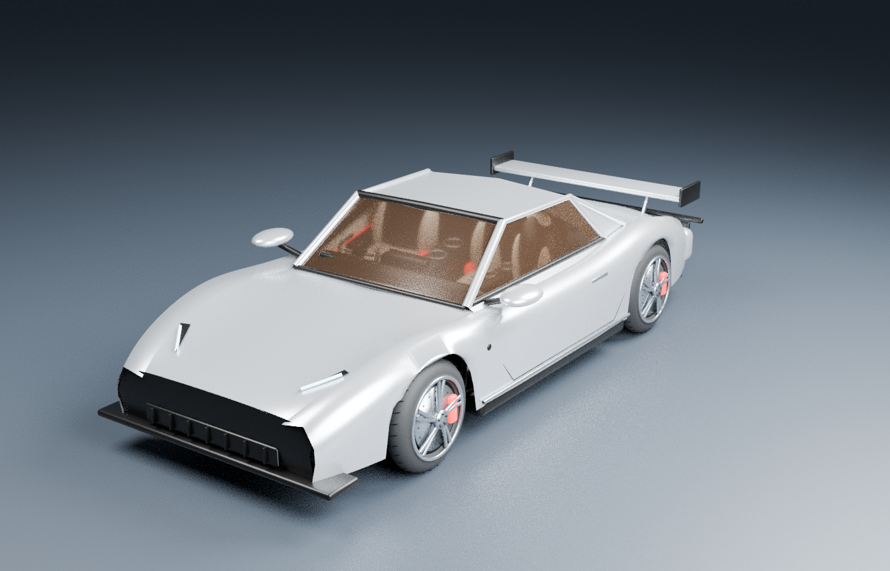

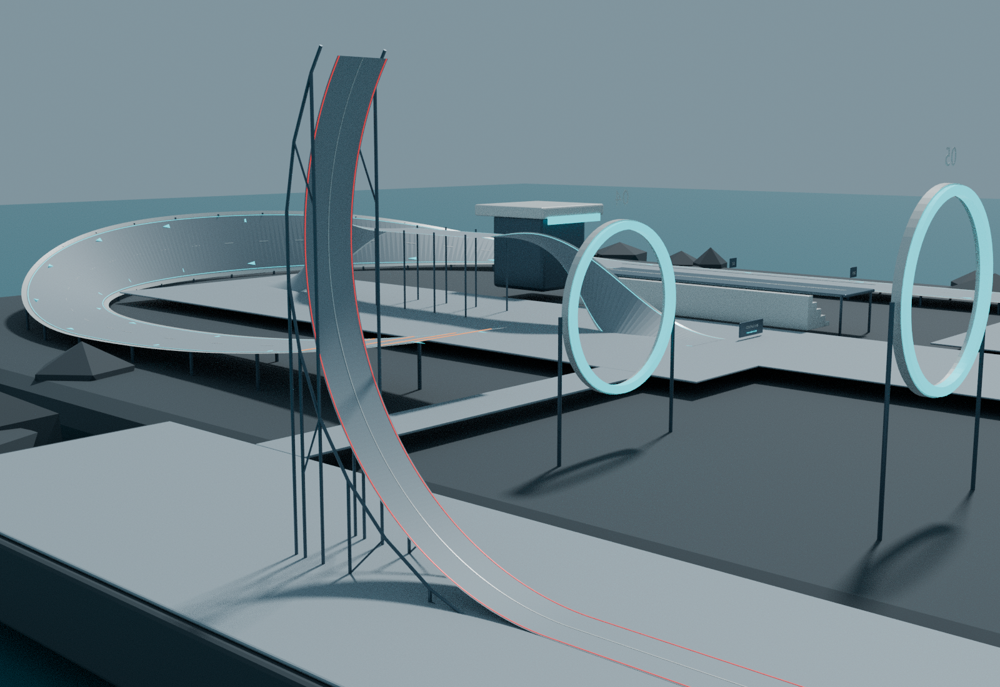
