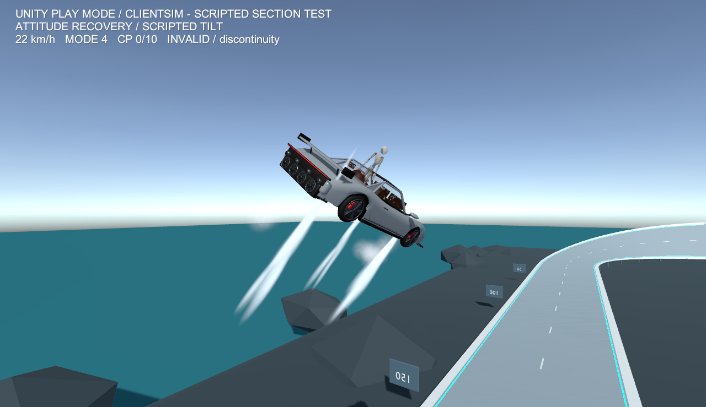
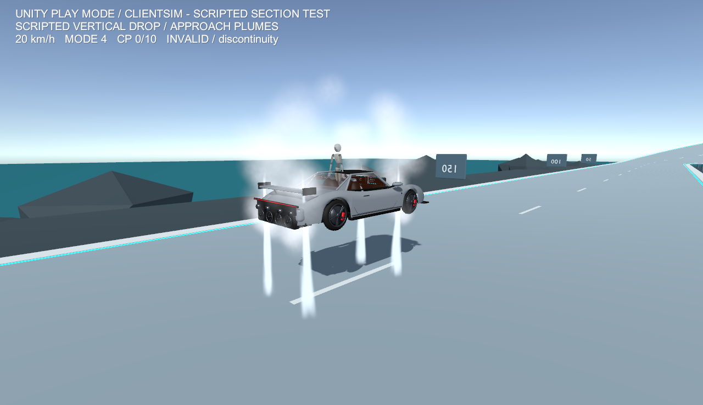
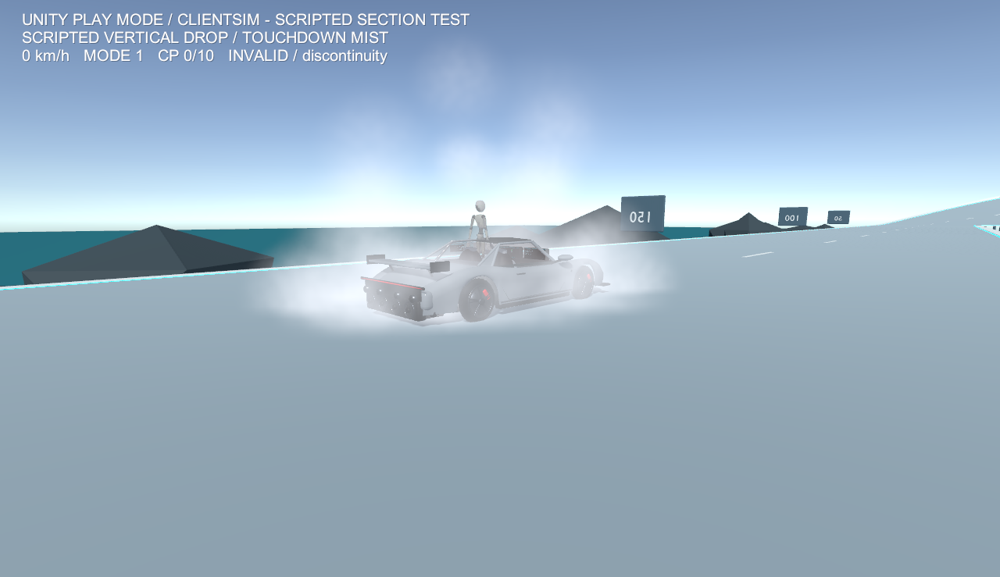
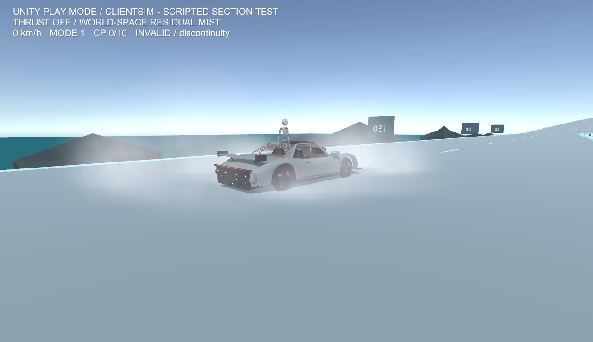

# スラスター姿勢補助・白煙・着陸補助

2026-10-17。公式映像の見える振る舞いを参考にしたゲーム用実装です。実車のノズル配置、噴射方式、推力、制御則、サスペンション性能を再現・測定したものではありません。

## 映像の観察と実装の対応

公式 X の動画を再生して確認した観察を共有し、次の区間を参照しました。時刻は動画プレーヤー表示を基準とする概数です。公式動画やフレームは本リポジトリに同梱しません。

| 映像・時刻 | 見えること | ゲームでの対応 |
|---|---|---|
| [Kickflip](https://x.com/Tesla/status/2110926164306931860) 20.4秒 | 回転中の車体から画面上方へ青白い噴流 | ノズル直近のジェットは車体座標で方向を保つ |
| 同 21.6秒 | 車体がほぼ水平へ戻り、複数の長い下向き噴流 | 四隅の下向きノズルと左右の制御ノズルを別々に駆動 |
| 同 21.9〜22.4秒 | 白い霧が横へ広がり、車体を覆う | 噴流が路面に届いた時点から面上に広がる霧 |
| 同 25.1秒 | 薄い残留霧 | 噴射停止後もワールド空間の粒子が寿命まで残る |
| [Ramp](https://x.com/Tesla/status/2110913438293647789) 23.9〜24.4秒 | 車体がまだ地面より上にある段階で、下側に大きな白い雲 | 接地イベントを待たず、噴流方向の Raycast 命中で霧を生成 |
| 同 25.9秒 | 車体が霧に隠れる | 地面上の霧と残留煙を重ねる |
| 同 27.6秒 | 編集カット後、回転中に少なくとも3本の分離した細い噴流 | 個別ノズルと独立した噴射強度。画面上の長さを実寸として使用しない |

噴射方向は画面上の観察で、実車のノズル角度の測定ではありません。接地瞬間やサスペンション反発は濃霧で隠れるため、減速度や反発量は映像から断定できません。以下の数値はすべてゲームの調整値です。自動キックフリップを追加したわけではなく、傾いた空中姿勢を水平へ戻す補助です。

## 姿勢補助とノズル

処理は `RoadsterVehicle.FixedUpdate` 内の owner ガードを通過したローカル運転者に限ります。非接地の mode 3 / 4 では、車体上向きから世界上向きへの最短 Quaternion 誤差を軸角へ変換し、角速度の減衰と操舵を加えます。

`requested = axis × angleRadians × 9 − angularVelocity × 4.5 + worldUp × steering × 2.5`

要求角加速度を大きさ 10 rad/s² に制限して `AddTorque(..., Acceleration)` へ渡します。車体座標の要求値 `attitudeCommand` を、そのまま噴射ミキサーへ渡します。タイマーだけで左右を交互点灯する演出ではありません。

| ノズル順 | 元モデルのアンカー | 排気方向（車体座標） | 表現する補正 |
|---:|---|---|---|
| 0 / 1 | Thruster_Down_FL / FR | −Y | 前側の pitch / 左右の roll と着陸出力 |
| 2 / 3 | Thruster_Down_L / R | −Y | 後側の pitch / 左右の roll と着陸出力 |
| 4 / 5 | Thruster_Front_L / R | −X / +X | yaw 要求の符号に応じた片側噴射 |
| 6 | Thruster_Rear | −Z | 許可区間での前進加速 |

上向きの力によるモーメント方向は `r × up = (−r.z, 0, r.x)`。正負の pitch / roll を四隅に配分し、出力を 0〜1 に制限します。四隅の排気と着陸推力は逆方向です。元モデルのアンカー位置を使用し、FBX の見た目用反転スケールを噴射のローカル軸へ持ち込まないため、ビルダーで車体直下に独立した噴射 Transform を生成します。

物理は安定化トルクと着陸加速度を直接適用するゲーム補助です。各ノズルの実推力、車体慣性、ガス流量を解く推進系シミュレーションではありません。既存の滑空揚力・壁面吸着もゲーム独自の補助として残ります。

## 高度と接近速度による着陸補助

車体位置の 0.5 m 上から世界下向きに、最大 12.5 m の Raycast を行います。路面法線の Y が 0.5 より大きい面だけを着地候補とし、自車・Trigger は除外します。車体と路面の法線方向距離を `h`、路面へ向かう速度を `v` とします。

`required = (v² − 1.3²) / (2 × max(h − 0.08, 0.15))`

降下速度が 1.3 m/s を超え、非接地で高度が 0.08〜12 m のとき、必要減速度に重力相当を加えます。車体上方向と路面法線の内積が 0.35 未満では噴射せず、まず姿勢を戻します。噴射可能な姿勢では法線への投影で補正し、最大 42 m/s² の車体上向き加速度を加えます。前進速度ベクトル全体を減衰・ゼロ化する処理は入れません。飛行許可中も、着地候補面を検知して降下している間は既存の滑空揚力を解除します。着陸補助がすでに重力を補償しているため、揚力を重ねて接地前に降下が止まる状態を避けます。

2本以上のサスペンション Raycast が当たると地上制御に戻り、着陸加速度は 0 になります。0.15秒以上の空中状態から接地した後の 0.35秒間は、路面法線方向の過大な反発速度を 0.65 m/s に制限します。接線方向速度をこの処理で削りません。これは積分前の制限であり、実測の反発上限そのものを保証する値ではありません。

`landingAssistEnabled` で補助オン／オフを比較できます。極端な降下速度、短い残り高度、強い傾き、斜面や縁では上限に達して減速しきれない場合があります。安全な着地を保証するものではありません。

## 白煙の3層

| 層 | 空間 | 初速 | 寿命 | 形状・役割 |
|---|---|---|---|---|
| ノズル直近のジェット 7系統 | Local | 14〜22 m/s | .18〜.30秒 | 細い円錐、速度方向に伸びる粒子。回転中もノズル方向へ追従 |
| 残留煙 7系統 | World | 4〜8 m/s | 1〜2.2秒 | 拡大・速度減衰・低品質 Noise。噴射後に車体へ付いて来ない |
| 地面上の霧 4系統 | World | 1.6〜3.2 m/s | 1.4〜2.6秒 | 広角の円錐で面上へ拡散。接地前にも発生 |

下向きノズルから排気方向へ 3 m の Raycast を行い、路面に命中した位置と法線へ地面の霧を配置します。命中距離が短いほど発生量を増やします。接地フラグだけでは生成しません。白〜薄い青白色の透明粒子で、炎や発光ブルームは使用しません。

全粒子はシーンに事前配置した18個の ParticleSystem を再利用します。Runtime に Instantiate / Destroy はありません。粒子上限はジェット7×64、残留7×64、地面4×96の **合計1,280個**。一系統一描画フレームの Emit は最大8個で、低FPS時の未処理発生量を持ち越し続けません。粒子 Collision と影は無効、Noise は Low。透明描画の GPU 負荷と VR 視認性は未計測です。

噴射強度は上昇14/s・下降9/sで平滑化します。通常の停止では既存粒子を消しません。Recover / reset sequence 変更では粒子をクリアし、ワープ元の煙がワープ先について来ないようにします。

## ネットワーク

7個の 0〜1 噴射要求をそれぞれ8bitへ量子化し、2個の同期 int に詰めます。従来の Manual snapshot と同時に送信します。生データは2 intですが、ヘッダー等を含む実通信量は未測定です。粒子の位置や個数は同期しません。

非 owner は受信した要求だけでローカル粒子を表示し、物理力は加えません。最後の snapshot から0.6秒以上経過したら新しい噴射を止め、残った煙は寿命まで表示します。ドライバー不在・復帰時も出力を停止します。複数クライアントでの実ネットワーク挙動は未検証です。

## 検証と画像

Unity 2022.3.22f1 / VRChat SDK 3.10.5、Windows、RTX 3070、ClientSim の simulated player 1人で、Udon VM と PhysX を実行しました。SDK入力イベントの自動送信と途中配置を使う区間試験です。姿勢／着陸のA/B試験では補助の有効値や初期姿勢をハーネスから設定します。実キーボード・VR操作や一周完走の試験ではありません。

最終実測値と成功数は [Unity検証報告](validation/UNITY_VALIDATION.ja.md) および [実行JSON](validation/clientsim-smoke.json) を参照してください。補助オン／オフの比較条件は高さ7 m、初期降下速度11 m/s、前進速度12 m/sで共通です。画像用の追加降下は前進速度0です。別途、飛行許可範囲内にPlay Mode限定の平面テスト台を置き、高度3 m・降下2 m/s・前進28 m/sからmode 3を経由して接地する回帰試験も実施しました。このテスト台は保存シーンに含めず、画像は元コースで撮影しています。

Play Mode / ClientSim。傾けた途中配置から姿勢復元中。車体向きに追従する噴流と、世界に残る煙。

Play Mode / ClientSim。高さ7 mからの自動垂直降下。高度・接近速度による制動中。

Play Mode / ClientSim。同じ垂直降下の接地付近。路面への噴流命中による白い霧。

Play Mode / ClientSim。噴射停止後、既存のワールド空間粒子が減衰する途中。

HUDの INVALID は検証のためのリセット・途中配置で計測を失格にしている表示です。タイムアタックの有効記録ではありません。公式映像そのものやBlenderレンダーではなく、生成したUnityシーンの実行キャプチャです。
